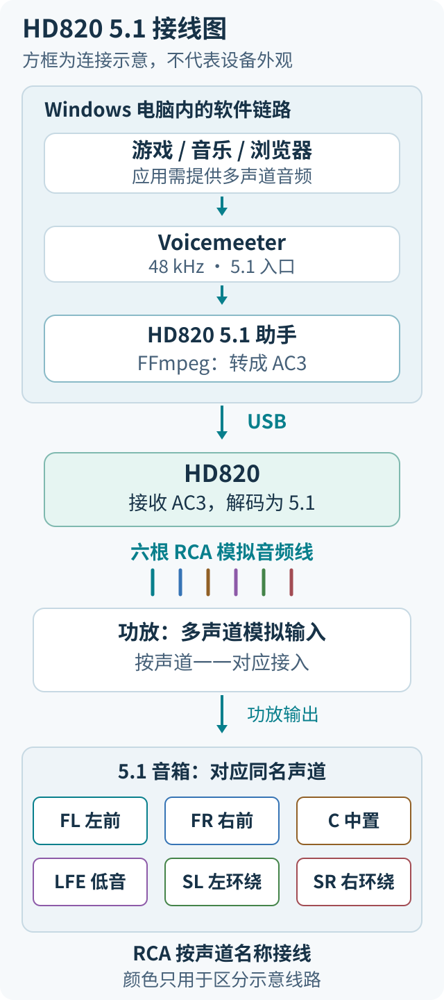
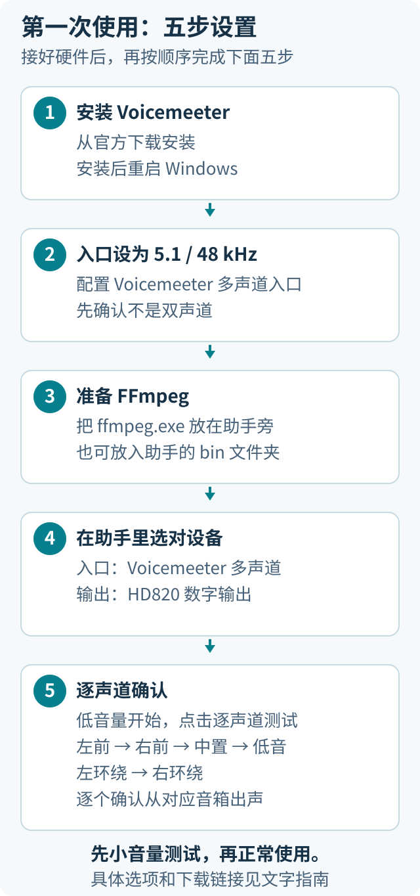
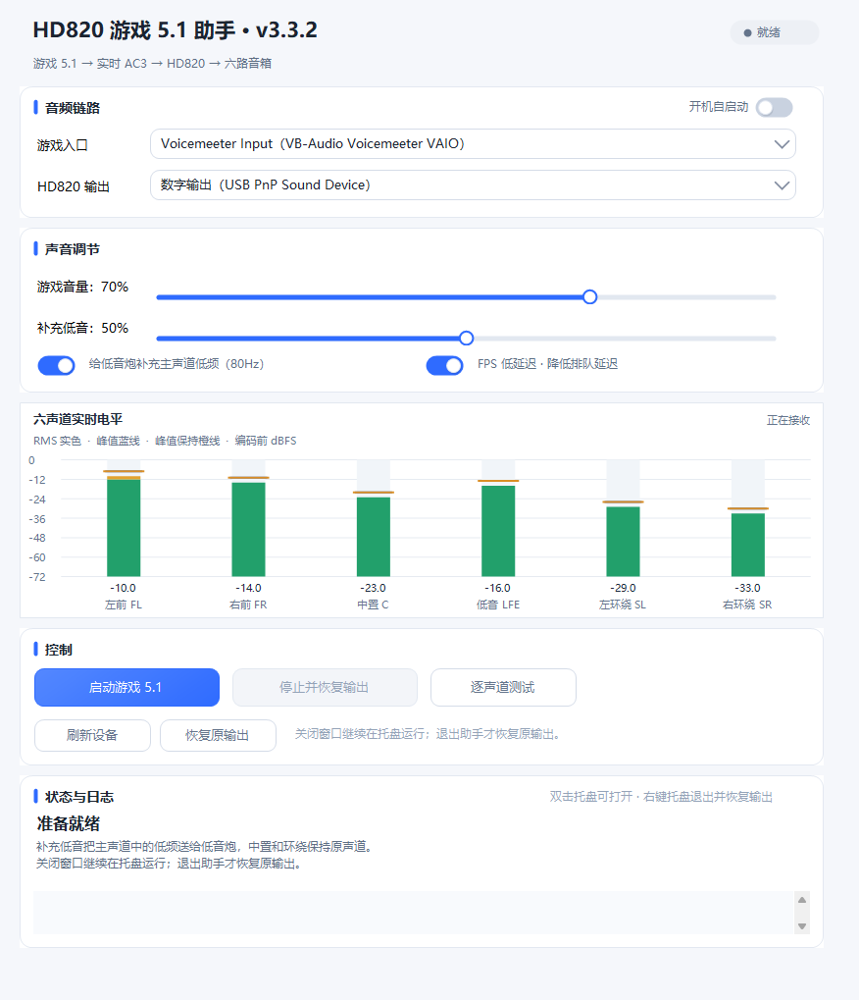
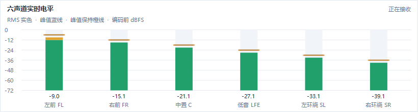

# HD820 5.1 助手

把 Windows 游戏、音乐和视频中的多声道声音送到 HD820，再通过六根 RCA 线连接功放和 5.1 音箱。提供六声道实时电平、低音补充、FPS 模式、登录自启和托盘后台运行。

**Windows 10 / 11 x64 · v3.3.2 · MIT**

[下载程序包](https://github.com/MoriAss/hd820-5.1-assistant/releases/download/v3.3.2/hd820-5.1-assistant-v3.3.2-windows-x64.zip) · [下载页与更新说明](https://github.com/MoriAss/hd820-5.1-assistant/releases/tag/v3.3.2) · [遇到问题](#遇到问题先查这里)

第一次使用，按下面顺序做。程序包已经编译好，不需要 Python、Visual Studio 或自己编译。**下载名字带 `windows-x64.zip` 的文件**；下载页自动生成的 `Source code` 是源码，不是可直接运行的程序。

## 先确认你有这些东西

| 需要什么 | 怎么确认 |
| --- | --- |
| Windows 10 / 11，64 位电脑 | 设置 → 系统 → 系统信息/关于，查看系统类型。目前完整实机验证在 Windows 11 上完成。 |
| HD820 / HD820Pro，USB 连接电脑 | Windows 能找到它的 USB **数字输出**，且设备支持通过该接口接收 AC3。不同固件不保证兼容。 |
| 有六路模拟输入的功放，或兼容的有源 5.1 音箱 | 接口通常标有 FL、FR、C、SW/LFE、SL/SR 或 SURROUND L/R。 |
| 六根 RCA 线及对应音箱 | 电脑到 HD820 用 USB；HD820 到功放用六根线，每根对应一个声道。 |

这是电脑上的音频助手，不替换厂商内核驱动，也不刷硬件固件。普通立体声仍只有原来的声道，本程序不会自动创造独立环绕，也不提供 Atmos 对象或天空声道。

## 1. 接好线，选对硬件输入



HD820 按对应型号手册切到 **USB-PC 电脑输入**和 **5.1 输出**；USB-PC 与播放U盘的USB模式可能不同。功放选多声道模拟输入，例如 `EXT. IN`、`MULTI CH IN` 或 `6CH IN`。接线时先调低功放音量。

两端同名接口一一对应，不要只看插头颜色：

| 接口标记 | 声道 |
| --- | --- |
| FL / Front L | 左前 |
| FR / Front R | 右前 |
| C / Center | 中置 |
| SW / SUB / LFE | 低音炮 |
| SL / Surround L / BL | 左环绕 |
| SR / Surround R / BR | 右环绕 |

本项目使用后两路连接一对环绕音箱；具体标签可能随解码器、功放而不同。

## 2. 下载需要的软件

| 软件 | 下载入口 | 选哪个、做什么 |
| --- | --- | --- |
| 本助手 | [直接下载 v3.3.2 程序包](https://github.com/MoriAss/hd820-5.1-assistant/releases/download/v3.3.2/hd820-5.1-assistant-v3.3.2-windows-x64.zip) | 全部解压到固定文件夹，例如 `D:\HD820助手`。以后登录自启会用这个位置。 |
| Voicemeeter | [VB-Audio 官方下载页](https://vb-audio.com/Voicemeeter/) | 下载 **Voicemeeter 标准版 / Basic**，提供多声道虚拟入口。不要误下成单独的 VB-CABLE。已有可用的多声道 VAIO 入口可以先沿用。 |
| FFmpeg | [下载 essentials ZIP](https://www.gyan.dev/ffmpeg/builds/ffmpeg-release-essentials.zip) · [Gyan 下载页](https://www.gyan.dev/ffmpeg/builds/) · [FFmpeg 官方入口](https://ffmpeg.org/download.html) | 选 `ffmpeg-release-essentials.zip`，解压后找 `bin\ffmpeg.exe`。Gyan提供Windows构建，FFmpeg负责实时编码AC3。 |
| .NET Framework | [微软 .NET Framework 4.8.1 页面](https://dotnet.microsoft.com/en-us/download/dotnet-framework/net481) | Windows 10/11通常已有兼容运行库，**先不用装**。提示缺少时查看系统要求，选 **Runtime**，不需要Developer Pack，也不是.NET 8/9。 |
| HD820 驱动/说明 | [厂商USB声卡说明](https://www.aoyint.com/pcusbdriver.html) · [HD820手册](https://www.aoyint.com/hd820manual.html) | 已能识别设备可沿用原驱动。缺少数字输出时向卖家索取对应型号/固件的驱动。厂商页面可能拒绝访问，不要从不明下载站随便装同名驱动。 |

Voicemeeter、FFmpeg和厂商驱动分别下载，不随本程序包分发。Voicemeeter按厂商的donationware条款使用，各依赖的许可见[第三方说明](THIRD_PARTY_NOTICES.md)。



## 3. 安装 Voicemeeter，然后重启电脑

1. 解压官方安装包，运行里面的安装程序，需要管理员权限时由你确认。
2. 按提示安装。**安装完成后重启电脑。**
3. 重启后继续下一步，先不用调整复杂的混音功能。

本助手直接使用虚拟播放端点，**不要求打开Voicemeeter混音器，也不需要配置A1**。把HD820数字输出留给本助手独占；若你另有Voicemeeter混音用途，不要让它同时占用这个输出。不同驱动版本仍需通过后面的逐声道测试确认。

完成的标志：Windows的**播放设备**里出现 `Voicemeeter Input (VB-Audio Voicemeeter VAIO)`。注意是 **Input**，不要选录音设备中的 `Voicemeeter Output`。

## 4. 把虚拟入口设为 5.1、48000 Hz

这里配置的是 **Voicemeeter Input**，不是HD820数字输出。

1. 按 `Win + R`，输入 `mmsys.cpl`，回车，打开“声音”窗口。
2. 进入“播放”，单击 `Voicemeeter Input (VB-Audio Voicemeeter VAIO)`。
3. 点左下角“配置”，选 **5.1 环绕声**。确认中置、低音和一对环绕存在，完成向导。
4. 选中同一个设备 →“属性”→“高级”。默认格式的采样率选 **48000 Hz**，位深可保留原值，点“应用”。
5. 如果该设备开启了Windows空间音效，先改为“关闭”，按普通5.1扬声器配置使用。

完成的标志：重新打开“配置”仍是5.1，“高级”仍是48000Hz。只有立体声、没有5.1时，先确认设备选对并完成安装后的重启。

**先保留原来的扬声器/耳机作为Windows默认输出，不要手动把Voicemeeter Input设为默认。**

助手启动后会负责切换，停止时还原。如果安装Voicemeeter已自动改了默认输出，先选回你平常使用的扬声器/耳机，再启动助手。

本项目也接受部分常规7.1布局并合并成5.1，但首次配置建议用5.1。不能使用44100Hz、96000Hz或任意六声道布局。

## 5. 把 ffmpeg.exe 放到助手旁边

1. 将本助手ZIP**全部解压**，不要在压缩包里直接运行EXE。
2. 解压FFmpeg ZIP，进入里面的 `bin` 文件夹。
3. 复制 **`ffmpeg.exe`** 到助手EXE所在文件夹。`ffplay.exe`和`ffprobe.exe`不能代替它。

最后至少应看到下面这些文件：

```text
D:\HD820助手\
├─ HD820游戏5.1助手.exe
├─ ffmpeg.exe                 ← 从FFmpeg的bin文件夹复制过来
├─ silence-ac3-640k.spdif      ← 程序包自带，请保留
├─ 开始使用.html              ← 双击查看本教程
├─ LICENSE
└─ docs\assets\              ← 教程配图
```

这种放法**不需要配置PATH环境变量**。如果使用过 `ffmpeg-path.txt`，它里面的路径优先；旧路径失效时要更新该文件，旁边放新的`ffmpeg.exe`不能覆盖旧配置。

## 6. 打开助手，选两个设备

双击 `HD820游戏5.1助手.exe`，先暂停游戏或音乐，把功放音量调低。



*界面示意由v3.3.2实际控件渲染，设备项及电平是演示数据，没有播放测试音。图中音量与开关不是你的必选值。*

| 界面位置 | 怎么选 |
| --- | --- |
| 游戏入口 | 选 `Voicemeeter Input (VB-Audio Voicemeeter VAIO)`；音乐、视频也共用这个入口。 |
| HD820 输出 | 选属于HD820的**数字输出**。本机名称是 `数字输出 (USB PnP Sound Device)`，不同系统可能不同。 |
| 游戏音量 | 从较低音量开始，逐步增加；它也影响音乐和视频。 |
| 补充低音 | 首次验证先关闭，确认原始六个声道后再按需开启。 |
| FPS 低延迟 | 可开启以减少软件排队，不能消除编码和硬件本身的延迟。 |

**不要把“HD820输出”选成普通扬声器、显示器或耳机端点。**

助手发送的是AC3编码载体，需要兼容解码器处理。多个USB音频设备名称相似时，要先核实对应硬件，程序不会替你猜选。

设备没出现时，检查USB、驱动和第4步，再点“刷新设备”。运行时设备选择会锁定，需先“停止并恢复输出”。

## 7. 先听六个声道，再打开游戏

1. 保持功放低音量。助手正在运行时，先点“停止并恢复输出”。
2. 点“逐声道测试”。约 **18秒**，每路约3秒，顺序为：

   **左前 → 右前 → 中置 → 低音 → 左环绕 → 右环绕**

3. 确认轮到哪个声道，就由对应音箱发声。低音测试声较低沉，不要按人声大小判断；测试会自动停止。
4. 测试正确后点“启动游戏5.1”。底部应显示“游戏5.1正在运行”，以及 **6声道 / 48000Hz**。
5. 再打开或重启游戏/播放器。应用输出选“默认设备”或 `Voicemeeter Input`；游戏有音频模式时选“5.1/环绕/家庭影院”。

助手启动时会将默认播放入口切到Voicemeeter，已打开的应用可能继续使用旧设备，所以要重新打开。应用如果自己指定了其他输出，也需改它自己的设置。



*合成测试信号示意。绿色柱是RMS电平，线条显示峰值；反映编码前的数字音频，不是音箱实测响度。*

环绕柱变化表示入口里有该声道数据，硬件端仍要听对应音箱确认。正常内容不会让六个声道始终一样响，中置或低音可能暂时没有信号。

## 日常怎么用

- 调通后打开“开机自启动”：当前用户**登录后**后台启动并尝试连接设备；未登录时不会播放。
- 点窗口右上角 **×** 会收起到托盘，5.1继续工作。双击托盘图标或再次双击助手EXE可以重新打开。程序不会自动创建桌面快捷方式，你可以自行创建。
- 真正退出：右键托盘图标 →“退出并恢复输出”。暂时停用则点“停止并恢复输出”。
- 自启开启后不要直接移动程序目录。换位置前先关闭自启并退出，移动后重新打开和启用自启。
- 最小化保留任务栏，关闭窗口退托盘，两者不同。

## 遇到问题先查这里

| 现象 | 先检查什么 |
| --- | --- |
| 找不到FFmpeg | `ffmpeg.exe`是否和助手EXE在一起？是否有指向旧位置的`ffmpeg-path.txt`？ |
| “游戏入口”为空 | Voicemeeter安装后是否重启？选的是播放端Input吗？是否5.1、48000Hz？ |
| “HD820输出”为空 | 检查USB、供电、厂商驱动和Windows数字输出。不要用其他USB声卡代替。 |
| 输出被占用或不支持 | 关闭占用HD820输出的PotPlayer直通、播放器或其他音频软件再试。仍失败时记录完整错误；设备/固件可能不支持该独占AC3格式。 |
| 六根柱子都不动 | 应用是否正在播放、是否静音、是否指定了别的输出？选默认/Voicemeeter Input并重新打开应用。 |
| 只有前两根柱子动 | 当前输入是立体声。检查游戏环绕选项或播放器音轨；助手不自动把所有立体声变成独立5.1。 |
| 柱子动，音箱不响 | 检查HD820的USB-PC/5.1模式、功放多声道模拟输入、RCA、静音和音量，再逐声道测试。 |
| 低音炮不响 | 先测低音声道。内容可能没有LFE；想补充主声道低频时可开启“补充低音”，逐步调节。 |
| 声道位置错 | 按两端接口标记核对RCA，不要用软件音量掩盖接线错误。 |
| 延迟大或偶尔卡顿 | 确认FPS模式，记录发生时刻、应用、模式和欠载/丢包计数，写进[Issue](https://github.com/MoriAss/hd820-5.1-assistant/issues)。不要直接上传含私人路径的全部日志。 |
| 关窗口后仍有声音 | 这是后台功能；使用托盘“退出并恢复输出”才能完全退出。 |

## 支持到什么程度

已验证HD820 → 六路模拟RCA → 天龙AVR-1507 → 5.1音箱这条链路；v3.3.2通过13组离线回归及六路编解码检查。其他设备、固件和应用需要分别验证。

输出为普通 **5.1 AC3，640kbps，有损编码**。AC3每帧在48kHz下为32ms，采集、排队、USB和硬件解码还会增加延迟。FPS模式不等于零延迟；本项目没有承诺消除所有卡顿，也没有完成端到端延迟测量。

音乐和浏览器能否使用，取决于应用是否提供多声道PCM、内容和账号权限。本助手不提供杜比授权、不绕过服务限制。**macOS、PS5暂无可用移植版。**

## 给想自己编译的人

普通使用者可以跳过本节。源码解压后，在项目目录的Windows PowerShell中运行：

```powershell
powershell.exe -NoProfile -ExecutionPolicy Bypass -File .\build.ps1
```

输出在`dist`，自行按前面的步骤放入FFmpeg。使用系统.NET Framework C#编译器，构建不会安装驱动、改默认音频设备或启用自启。

离线回归需要Python和测试依赖：

```powershell
python -m pip install -r .\tests\requirements.txt
python .\tests\run_tests.py --ffmpeg C:\tools\ffmpeg\bin\ffmpeg.exe
```

测试不打开物理音频输出。命令行参数见[开发者说明](docs/DEVELOPMENT.md)，另有[架构说明](docs/ARCHITECTURE.md)、[调试记录](docs/DEBUG-20261103.md)和[验证摘要](docs/VALIDATION-3.3.2.json)。

## 开源协议

[MIT License](LICENSE)，Copyright (c) 2026 MoriAss。允许使用、修改、分发和商用，须保留版权声明与许可文本。第三方依赖仍遵守各自的[许可证或厂商条款](THIRD_PARTY_NOTICES.md)。
